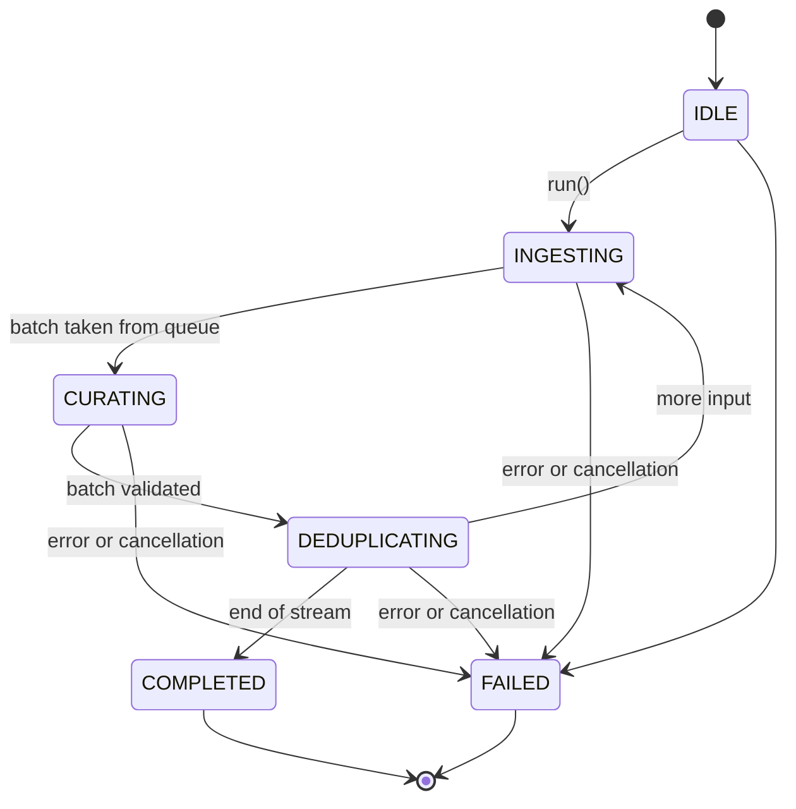
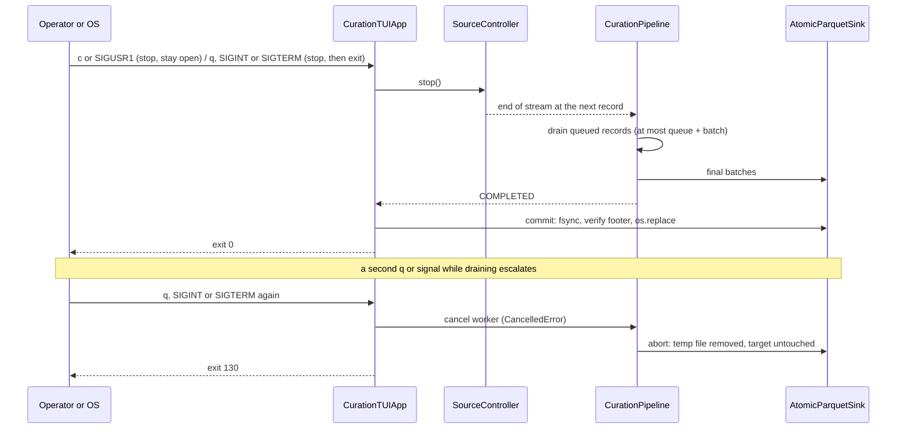
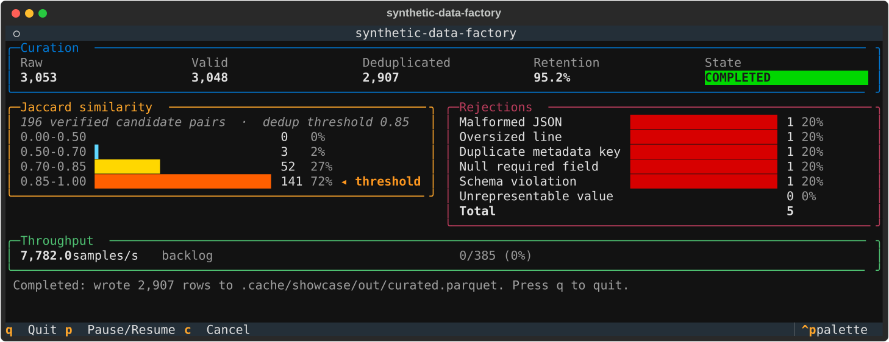

# synthetic-data-factory

Curation pipeline for synthetic instruction datasets: strict data contracts,
MinHash LSH near-duplicate removal with exact Jaccard verification, atomic
Parquet export, and a live terminal dashboard.

[](https://github.com/mikeZ98/synthetic-data-factory/actions/workflows/ci.yml)


-brightgreen)


Static badges record the `v0.1.0` baseline; the CI badge is live. Every number
in this document comes from a command you can rerun, and each section names it.

## Contents

1. [Verified baseline](#verified-baseline)
2. [Architecture](#architecture)
3. [Empirical results](#empirical-results)
4. [Terminal dashboard](#terminal-dashboard)
5. [Quickstart and operator runbook](#quickstart-and-operator-runbook)
6. [Storage and hardware isolation](#storage-and-hardware-isolation)
7. [Semantics and known limits](#semantics-and-known-limits)
8. [Repository layout](#repository-layout)

## Verified baseline

| Claim | Result | Evidence |
|---|---|---|
| Line and branch coverage | **100.00%** on all 31 measured files (`src/`, `tools/`); 619 tests passed, 0 skipped | `scripts/coverage-gate.sh` |
| Coverage bypasses | `src/` has **zero** suppressions: no `pragma: no cover`, `type: ignore`, `noqa` or `nosec`. Coverage excludes only `if TYPE_CHECKING:`, `@overload` stubs and `if __name__ == "__main__":` | `grep -r pragma src`; `[tool.coverage.report]` |
| Static analysis | `mypy --strict`: 0 errors in 55 source files; ruff (E, F, W, I, UP, B, SIM, S) clean; bandit clean | `uv run mypy src tests tools --strict` |
| Mutation score | **100.00%**: 257 of 257 non-equivalent mutants killed, 10 documented equivalents, 0 survivors | `scripts/run-mutation-tests.sh` |
| Network isolation | Every test runs with `AF_INET`/`AF_INET6` sockets disabled; a test proves the block is active | `pytest-socket`, `tests/test_network_isolation.py` |
| Reproducible image | Three clean builds on two different BuildKit engines produce one digest | [Reproducibility](#container-hardening-and-reproducibility) |
| Storage isolation | All tool state under `./.cache/`; the container runtime on the external SSD; 0 home-directory writes by the toolchain in a measured window | [Isolation](#storage-and-hardware-isolation) |
| Sole committer | Every commit authored and committed by `mikeZ98`, Conventional Commits, no trailers | `scripts/audit-attribution.sh` |

Where it was verified:

| Environment | What ran |
|---|---|
| macOS 27.2, Apple Silicon (arm64), Python 3.12.13 | every gate, mutation run, benchmarks, container builds on Colima |
| Linux arm64 container (`python:3.12-slim-bookworm`) | every CI job's commands, including the mutation gate (identical table) |
| GitHub Actions `ubuntu-24.04` (amd64) | all six CI jobs, [run 42503102454](https://github.com/mikeZ98/synthetic-data-factory/actions/runs/42503102454) |

## Architecture

### Data path

```mermaid
flowchart LR
    subgraph ingest["Ingestion: bounded memory"]
        J["JSONL<br/>readline(max_line_bytes + 1)"]
        P["Parquet<br/>iter_batches per row group"]
        R["StreamingDatasetReader<br/>strict Pydantic v2 validation<br/>rejections counted by reason"]
    end
    J --> R
    P --> R
    R --> C["SourceController<br/>pause and graceful stop"]
    C --> Q[["asyncio.Queue(maxsize)<br/>backpressure"]]
    Q --> B["micro-batch in canonical order<br/>(created_at_utc, sample_id)"]
    subgraph dedup["MinHashLSHIndex"]
        S["TextShingler<br/>NFC, lowercase, collapse whitespace<br/>keyed BLAKE2b-64 k-shingles"]
        M["MinHash signature<br/>(a x + b) mod 2^31-1 on uint64"]
        L["LSH bands b x r = num_perm<br/>inverted index, at most max_candidates"]
        V{"exact Jaccard >= threshold?"}
    end
    B --> S --> M --> L --> V
    V -- "yes: drop" --> X(("dropped"))
    V -- "no: insert and keep" --> A["Arrow RecordBatch<br/>canonical schema"]
    A --> W["AtomicParquetSink<br/>exact row groups"]
    W --> T[".tmp.uuid.parquet<br/>flush and fsync"]
    T --> F{"footer verification<br/>schema, rows, layout"}
    F -- "ok" --> O["os.replace and directory fsync"]
    F -- "drift" --> AB["abort: unlink temp file"]
```



Design contracts, each enforced by tests:

* **Strict boundaries.** Records are validated by frozen Pydantic v2 models: no
  coercion, no NaN or Inf, explicit UTC, UTF-8-safe text, relative output paths.
  The Arrow layer allows only specific source types (PyArrow would silently cast
  `int64` to `"7"` and naive timestamps to UTC) and checks that `keys_sorted`
  maps really are sorted.
* **Deterministic deduplication.** Hashes are keyed BLAKE2b, independent of
  `PYTHONHASHSEED`, process and byte order, with golden values pinned. Each
  batch is processed in canonical order, so the output does not depend on input
  order. A drop happens only after **exact** Jaccard verification, so LSH
  collisions cannot cause false positives.
* **Bounded work.** The queue, reader buffers and sink buffer are bounded. Each
  query verifies at most `max_candidates` candidates, and truncated queries are
  counted.
* **Atomic output.** Readers see either the previous file or the complete new
  one. Any failure, exception or cancellation removes the temp file.

### Pipeline state machine



One cycle runs per micro-batch. The transition table is tested exhaustively
(all 36 state pairs). Producer and metrics tasks are `TaskGroup` children, so
no task outlives `run()`. Metrics go through a latest-value slot that never
blocks the pipeline: a slow hook sees skipped intermediate snapshots, but
always receives the final one.

### Interruption: graceful drain and hard abort



The graceful path ends the input stream instead of cancelling anything, so the
pipeline completes normally and the sink commits a valid file. Tests send real
`SIGTERM`, `SIGUSR1` and repeated `SIGINT` to the test process, and the
container smoke test runs `docker stop` mid-run.

## Empirical results

Benchmarks: `uv run --locked python -m tools.benchmark` (seeded corpus, results in
`.cache/benchmark/results.json`). Measured on Apple Silicon (arm64), Python 3.12.13.

### Algorithmic complexity: exhaustive pairwise vs MinHash LSH

The corpus has 40-token documents, and about 30% are copies of an earlier
document with 0-3 tokens replaced. Settings are threshold 0.7, 3-word shingles
and 128 permutations (16 bands x 8 rows). The exhaustive baseline compares each
document with every kept document using exact Jaccard: greedy keep-first,
O(N²).

| N | Exhaustive time | Exhaustive comparisons | LSH time | LSH comparisons | Comparison reduction | Drops (exhaustive / LSH) | LSH agreement |
|---:|---:|---:|---:|---:|---:|---:|---:|
| 1,000 | 0.28 s | 340,351 | 0.05 s | 240 | 1,418x | 229 / 214 | 91.27% |
| 2,000 | 1.07 s | 1,367,425 | 0.10 s | 473 | 2,891x | 443 / 411 | 91.20% |
| 5,000 | 6.47 s | 8,612,511 | 0.25 s | 1,206 | 7,141x | 1,096 / 1,024 | 91.97% |
| 10,000 | 25.48 s | 34,434,379 | 0.50 s | 2,403 | 14,330x | 2,203 / 2,055 | 92.15% |
| 20,000 | — | — | 1.05 s | 4,768 | — | — / 4,071 | — |
| 50,000 | — | — | 2.80 s | 11,964 | — | — / 10,221 | — |
| 100,000 | — | — | 5.69 s | 23,911 | — | — / 20,460 | — |

The exhaustive method's comparisons grow quadratically (4x per doubling).
LSH comparisons stay near 0.24 per document and time near 57 µs per document,
linear across two orders of magnitude. **Agreement** is the share of the
exhaustive method's drops that LSH also made. About 8% of borderline pairs are
missed: that is the recall cost of banding, concentrated just above the
threshold. LSH never drops something the exact check rejects. More bands
improve recall, at the cost of more candidate checks.

### Memory profile

Peak RSS per run, each in a fresh process. **stream** runs the reader into
the sink with no index, isolating the bounded buffers. **curate** is the full
pipeline.

| Records | Mode | Baseline RSS | Peak RSS | Growth | Kept |
|---:|---|---:|---:|---:|---:|
| 10,000 | stream | 95 MiB | 116 MiB | +21 MiB | 10,000 |
| 50,000 | stream | 95 MiB | 123 MiB | +28 MiB | 50,000 |
| 100,000 | stream | 95 MiB | 125 MiB | +30 MiB | 100,000 |
| 10,000 | curate | 95 MiB | 169 MiB | +74 MiB | 7,941 |
| 50,000 | curate | 95 MiB | 403 MiB | +308 MiB | 39,818 |
| 100,000 | curate | 95 MiB | 696 MiB | +601 MiB | 79,577 |

* **Streaming memory is flat.** A 10x larger input adds 9 MiB, consistent with
  the bounded reader, queue and row-group buffer. Tests check the same thing
  more strictly: Parquet peak Arrow allocation for a 4x larger file must stay
  within 1.5x (+512 KiB) of the smaller file's, and JSONL streaming of a 9 MB
  file must peak below 1/20 of its size.
* **Index memory grows linearly with kept documents**, by design. Exact
  verification needs every kept document's shingle set. The measured cost is
  about **7.7 KiB per kept document** with `frozenset[int]` storage, roughly
  7.5 GiB per million kept documents. See [known limits](#semantics-and-known-limits).

### Mutation testing

`scripts/run-mutation-tests.sh` uses a custom AST mutator (`tools/mutation.py`).
Each worker runs against a private copy of `src/` under `.cache/mutation/`, so
the repository source is never modified. Before scoring, the harness checks
that the package imports from the worker copy, that the baseline tests pass,
and that a deliberately broken target fails them.

| Target | Mutants | Killed | Timeout | Survived | Equivalent | Score | Required |
|---|---:|---:|---:|---:|---:|---:|---:|
| `core/shingler.py` | 47 | 47 | 0 | 0 | 0 | 100.00% | 100% |
| `core/deduplicator.py` | 133 | 123 | 0 | 0 | 10 | 100.00% | 100% |
| `transport/parquet_sink.py` | 87 | 87 | 0 | 0 | 0 | 100.00% | 100% |
| **total** | **267** | **257** | **0** | **0** | **10** | **100.00%** | |

The operators are comparison boundaries, arithmetic and augmented assignment,
`and`/`or`, removal of `not`, negated conditions, integer and boolean
constants, call-statement deletion (for example a deleted `fsync`, `os.replace`
or `unlink`), keyword-argument removal (for example tie-break `key=`), and
`break`/`continue` swaps.

The 10 equivalents are listed with written justifications in
`tools/mutation.toml`. An entry that stops matching a surviving mutant fails
the run.

| Equivalence class | Count | Why it cannot change behaviour |
|---|---:|---|
| Which set the Jaccard loop iterates | 2 | `\|A ∩ B\|` is symmetric and the denominator uses both lengths, so only speed changes |
| `range(1, n + 1)` becomes `range(1, n + 2)` in the band search | 1 | the extra candidate `b = n + 1` never divides `n` |
| `np.fromiter(count=)`, `astype(copy=)` | 3 | allocation hints; the values are identical |
| `zip(..., strict=True)` relaxed | 4 | both sequences have length `bands` by construction |

The first run scored **87.68%** even though coverage was already 100%. The 34
survivors were triaged into 16 real test gaps, now killed, 8 dead or redundant
code paths, now removed, and the 10 equivalents above. Two of the gaps:

* **Durability:** deleting `flush()` before `fsync` would sync a 0-byte file
  while the footer sat in Python's buffer.
* **Descriptor leak:** deleting `os.close()` in the directory fsync leaked a
  descriptor on every commit.

### Container hardening and reproducibility

| Control | Implementation | Verified by |
|---|---|---|
| Base image | `python:3.12-slim-bookworm`, pinned by multi-arch index digest | CI amd64 build, local arm64 build |
| Build tooling | uv 0.11.7 pinned by digest, present in the build stage only | smoke: no `pip`, `uv`, `gcc`, `cc`, `g++`, `make` |
| User | UID and GID 10001, `nologin`, `HOME=/nonexistent` | smoke: `id -u`, `id -g` |
| Bytecode | `checked-hash` for all **3,384** modules (stdlib and venv) | smoke: every `.pyc` header has flags `0b11` |
| Root filesystem | `--read-only`, plus a `tmpfs` at `/tmp` (`noexec,nosuid,size=64m`) | smoke full run; compose `read_only: true` |
| Network | `--network none` / `network_mode: none` | smoke; compose |
| Privileges | `--cap-drop ALL`, `no-new-privileges` | smoke; compose |
| Resources | `cpus: 2.0`, `mem_limit: 1g`, no swap beyond that, `pids_limit: 256` | `docker compose config` |
| Signals | `SIGTERM` triggers the graceful drain, exit 0, committed partial output | smoke: `docker stop` mid-run committed about 176k-180k of 300k records, with no temp files |
| Cold start | stdlib `.pyc` precompiled; the official image strips them, and a read-only root filesystem cannot cache them | about 0.4 s for `--help`, including container creation |

**Bit-for-bit reproducibility.** The build uses `SOURCE_DATE_EPOCH` and
`rewrite-timestamp=true` and exports OCI archives. Three `--no-cache` builds of
the same tree produced one manifest digest and byte-identical archives: two on
the daemon's embedded BuildKit and one on standalone BuildKit v0.25.1 in a
`docker-container` builder. Diffing builds layer by layer found and fixed three
sources of drift:

1. **uv's cache marker.** uv writes `uv_cache.json` (a wall-clock time and an
   inode) into `dist-info`. It is removed, along with its `RECORD` line.
2. **Parallel marshalling.** `marshal` sets `FLAG_REF` from refcounts, and
   parallel `compileall` workers have different interning histories, so they
   emit byte-different `.pyc` files. Compilation runs sequentially (`-j 1`).
3. **Side-effect bytecode.** Modules imported by `compileall` and `pip`
   themselves received timestamp `.pyc` files and were then skipped as up to
   date. Every helper now runs with `python -B`, and compilation uses `-f`.

The digest depends on every input, including `README.md` (the package's long
description). That is why this document states a method and a result rather
than a fixed digest.

**Image size** is about 1.0 GB. The venv is 573 MiB: Polars runtime 160 MiB,
PyArrow 155 MiB, NumPy 68 MiB and SciPy 149 MiB. SciPy is pulled in only by
`datasketch`, which is now used only by one conformance test; moving it to the
dev group would save about 150 MiB.

## Terminal dashboard

A real render of `CurationTUIApp` at completion, on a dataset built to hit
every panel (`uv run --locked python -m tools.showcase`, which also writes the
SVG below):



```text
 ⭘                                             synthetic-data-factory
╭─ Curation ─────────────────────────────────────────────────────────────────────────────────────────────────────────╮
│          Raw                   Valid              Deduplicated             Retention                State          │
│         3,053                  3,048                  2,907                  95.2%                 COMPLETED       │
╰────────────────────────────────────────────────────────────────────────────────────────────────────────────────────╯
╭─ Jaccard similarity ───────────────────────────────────╮ ╭─ Rejections ────────────────────────────────────────────╮
│ 196 verified candidate pairs  ·  dedup threshold 0.85  │ │ Malformed JSON         ████████████████████ 1 20%       │
│ 0.00-0.50                            0  0%             │ │ Oversized line         ████████████████████ 1 20%       │
│ 0.50-0.70 ▌                          3  2%             │ │ Duplicate metadata key ████████████████████ 1 20%       │
│ 0.70-0.85 ████████▉                 52 27%             │ │ Null required field    ████████████████████ 1 20%       │
│ 0.85-1.00 ████████████████████████ 141 72% ◂ threshold │ │ Schema violation       ████████████████████ 1 20%       │
╰────────────────────────────────────────────────────────╯ │ Unrepresentable value                       0  0%       │
                                                           │ Total                                       5           │
                                                           ╰─────────────────────────────────────────────────────────╯
╭─ Throughput ───────────────────────────────────────────────────────────────────────────────────────────────────────╮
│ 7,782.0 samples/s  backlog                                 0/385 (0%)                                              │
╰────────────────────────────────────────────────────────────────────────────────────────────────────────────────────╯
 Completed: wrote 2,907 rows to .cache/showcase/out/curated.parquet. Press q to quit.
 q Quit  p Pause/Resume  c Cancel                                                                         ▏^p palette
```

* **Curation HUD.** Raw means records read. Valid means records that passed
  the strict contract. Deduplicated means records kept. Retention is kept
  divided by raw. The badge shows the state machine, plus `PAUSED` while paused
  and `STOPPED` after an interrupted completion.
* **Jaccard similarity.** Exact similarity of every verified LSH candidate
  pair, in the buckets [0, 0.5), [0.5, 0.7), [0.7, 0.85) and [0.85, 1]. The
  bucket containing the threshold is marked. Pairs at or above the threshold
  are drops; pairs below it were LSH collisions that exact verification
  rejected.
* **Rejections.** Every reject reason in a fixed order, with proportional bars.
* **Throughput.** A rolling 5-second rate, and backlog: records handed to the
  pipeline but not yet processed, against the queue + batch + 1 bound.

## Quickstart and operator runbook

```sh
uv sync --locked
uv run synthetic-data-factory data/a.jsonl data/b.parquet -o out/curated.parquet
uv run python -m synthetic_data_factory.tui ...        # equivalent module entrypoint
uv run synthetic-data-factory in.jsonl -o out/x.parquet --headless --auto-exit   # scripts and CI
```

| Flag | Default | Meaning |
|---|---|---|
| `INPUT ...` | required | `.jsonl` / `.ndjson` / `.parquet`, read in order |
| `-o, --output` | required | **relative** path ending in `.parquet`; no `..`, `~` or drive letters |
| `--threshold` | `0.85` | exact-Jaccard duplicate threshold, in (0, 1] |
| `--num-perm` | `128` | MinHash permutations: a power of two, 16-4096 |
| `--shingle-k` | `5` | word shingle size, 2-64 |
| `--batch-size` | `256` | micro-batch size; also bounds how long the UI can block |
| `--queue-size` | `1024` | ingestion queue bound (backpressure) |
| `--compression` | `zstd` | `zstd`, `snappy` or `gzip` |
| `--row-group-size` | `100000` | rows per Parquet row group (at least 1000) |
| `--headless` / `--auto-exit` | off | no terminal display / exit when the run ends |

Invalid arguments exit with status 2 and a message; they are validated by the
same Pydantic contracts the pipeline uses.

| Key or signal | Effect | Exit code |
|---|---|---|
| `p` | pause or resume at the next record | n/a |
| `c`, `SIGUSR1` | graceful stop: drain, commit, keep the UI open | n/a |
| `q`, `ctrl+q`, `SIGINT`, `SIGTERM` | graceful stop, commit, exit | 0 (1 if the run failed) |
| second `q` or signal while draining | cancel; output discarded atomically | 130 |

### Containers

```sh
docker build -f deploy/Dockerfile -t synthetic-data-factory:v0.1.0 .
deploy/smoke-test.sh                       # non-root, no dev tools, bytecode, read-only run, SIGTERM

docker run --rm --read-only --tmpfs /tmp:rw,noexec,nosuid,size=64m \
  --network none --cap-drop ALL --security-opt no-new-privileges:true \
  -v "$PWD/data:/data" synthetic-data-factory:v0.1.0 \
  in.jsonl -o out/curated.parquet --headless --auto-exit

SDF_INPUT=in.jsonl docker compose -f deploy/docker-compose.yml --profile batch up --exit-code-from curate
```

Compose mounts `SDF_DATA_DIR` (default `./.cache/data`) at `/data`. Inputs and
the output path are relative to it.

### Gates

```sh
uv run --locked ruff check && uv run --locked ruff format --check
uv run --locked mypy src tests tools --strict
uv run --locked bandit -c pyproject.toml -r src
scripts/coverage-gate.sh                    # 100.00% line + branch, network-free
scripts/run-mutation-tests.sh               # mutation score per target (about 2.5 min on 7 workers)
scripts/audit-hygiene.sh                    # no host paths, no macOS artifacts, caches isolated
scripts/audit-attribution.sh                # sole committer, Conventional Commits, no trailers
uv run --locked pytest --hypothesis-profile=ci   # derandomized Hypothesis
```

CI (`.github/workflows/ci.yml`) runs the same commands in six jobs. Actions are
pinned to commit SHAs, and the attribution audit checks out the PR head rather
than GitHub's synthetic merge commit. Merges must be made locally: commits
created by GitHub's web UI carry a GitHub committer and fail the
sole-committer audit by design.

## Storage and hardware isolation

### What lives where

| State | Location | Mechanism |
|---|---|---|
| Repository and `.venv` | external SSD (`/Volumes/<SSD>/Projects/...`) | clone location |
| uv package cache | `./.cache/uv` | `[tool.uv] cache-dir`; `UV_CACHE_DIR` |
| Managed CPython | `/Volumes/<SSD>/.uv_python` | `UV_PYTHON_INSTALL_DIR` in the shell profile |
| ruff, mypy, pytest, coverage, bytecode | `./.cache/{ruff,mypy,pytest,coverage,pycache}` | `pyproject.toml`; `PYTHONPYCACHEPREFIX` |
| Hypothesis database, pytest `tmp_path` | `./.cache/hypothesis`, `./.cache/pytest-tmp` | `tests/conftest.py`; `--basetemp` |
| Mutation workers, benchmarks, showcase | `./.cache/{mutation,benchmark,showcase}` | tool defaults |
| Container VM disk | `$COLIMA_HOME/_lima/_disks` on the SSD | `COLIMA_HOME` |
| Docker CLI state (contexts, buildx) | `$DOCKER_CONFIG` | for example the project-local `./.cache/docker` |

`scripts/audit-hygiene.sh` enforces the repository side. It covers every
tracked or trackable file and every path in history, and fails on absolute
host paths (home directories, mount points under `/Volumes`, temp
directories, Windows paths), macOS artifacts (`.DS_Store`, `._*`, `__MACOSX`, `Icon\r`), or tool
state outside `./.cache/`. The Docker build context is an allowlist
(`pyproject.toml`, `uv.lock`, `README.md`, `src/`), so `.cache/`, `.venv/` and
`.git/` can never enter an image.

### Running the container runtime from the SSD (Colima)

```zsh
export COLIMA_HOME="/Volumes/<SSD_NAME>/.colima"
export DOCKER_CONFIG="$PWD/.cache/docker"      # or a user-owned directory on the SSD
colima start --cpu 4 --memory 6 --disk 40 --vm-type vz --mount-type virtiofs --runtime docker \
  --mount "/Volumes/<SSD_NAME>/Projects:w" --ssh-config=false
```

Lessons from setting this up:

* **Grant the SSD path explicitly.** Without `--mount`, Colima shares only
  `$HOME` with the VM. A bind mount of an SSD path then becomes an empty,
  root-owned directory *inside the VM*, silently. Passing `--mount` also
  replaces the default `$HOME` share, so the VM cannot write to the home
  directory at all, which is the stricter setup. `deploy/smoke-test.sh` uses a
  named volume, so it works regardless of mounts.
* **`--ssh-config=false`** stops Colima from maintaining an `Include` line in
  `~/.ssh/config`.
* **The volume root is usually `root:wheel`.** `/Volumes/<SSD>/.docker` needs
  a one-time `sudo mkdir` and `chown`. A project-local `DOCKER_CONFIG` needs
  neither.
* **CLI plugins.** A relocated `DOCKER_CONFIG` does not see
  `~/.docker/cli-plugins`. Add `"cliPluginsExtraDirs"` to its `config.json`
  for `buildx` and `compose`.
* **Docker Desktop is not SSD-isolated.** Its VM disk lives in
  `$HOME/Library/Containers/com.docker.docker` on the internal disk.

### Measured host footprint

Method: a timestamp marker was set before `colima start`, then every file under
`$HOME` modified afterwards was listed (`find "$HOME" -xdev -newer marker`) and
attributed. The window covered starting the SSD Colima VM, three `--no-cache`
image builds, the tagged build, two full smoke-test runs, the benchmark suite,
the dashboard capture and the coverage gate.

| Origin | Files |
|---|---:|
| **project toolchain and container runtime** (uv, Python, pytest, Hypothesis, Textual, Docker CLI, Colima, Lima) | **0** |
| macOS system services (Spotlight, Biome, Duet, IdentityServices, preferences) | 208 |
| unrelated applications (browser updater, input-device utility) | 5 |
| the coding-agent session that ran the measurement | 5 |
| a residual Docker Desktop log line from shutting it down | 1 |

What this shows, and what it does not: during heavy builds and batch runs,
the project's toolchain and container runtime wrote **nothing** to the home
directory. Their state went to `./.cache/` and the SSD VM disk. It does not
show that the internal disk was untouched: macOS writes to `~/Library` and the
system volume continuously, regardless of this project.

## Semantics and known limits

* **Greedy keep-first deduplication.** Each document is compared with the
  documents kept before it, in canonical order. Because similarity is not
  transitive, two intuitive properties are false, and both counterexamples are
  pinned as tests in `tests/core/test_fuzz_invariants.py`:
  * Inserting an *earlier* near-duplicate can resurrect a dropped record.
    Appending *later* records provably never changes earlier decisions, and
    exact-duplicate drops survive any addition.
  * Raising the threshold can drop *more* records (1 drop at 0.7, 2 at 0.8 on
    a four-set example). What holds is that drops at any threshold include at
    least the exact duplicates (drops at 1.0). If you need threshold
    monotonicity, deduplicate by connected components instead.
* **LSH recall** is about 92% of exhaustive drops near the threshold in the
  benchmark above. Precision is exact by construction.
* **Index memory** is O(kept), at about 7.7 KiB per kept document with
  `frozenset[int]` storage. Storing shingle sets as sorted `uint64` arrays
  would cut this several-fold. It is the main scaling item.
* **A single event loop.** The UI repaints between micro-batches, and
  `--batch-size` bounds how long it can block. Graceful stop takes effect at
  the next input record, so a stalled upstream needs the forced second
  interrupt.
* **Image size** is dominated by Polars, PyArrow and SciPy (see above).

## Repository layout

```text
src/synthetic_data_factory/
  schemas/      Pydantic v2 contracts: InstructionSample, CurationMetrics, MinHashConfig, ExportSpecification
  core/         shingler.py (NFC + keyed BLAKE2b), deduplicator.py (MinHash LSH + exact Jaccard),
                pipeline.py (state machine, bounded queue, TaskGroup)
  transport/    schema.py (canonical Arrow schema, conform), parquet_sink.py (atomic sink), reader.py
  tui/          widgets/ (HUD, rejections, Jaccard histogram, throughput), app.py, control.py, telemetry.py
  cli.py        argument parsing through the same contracts
tests/          schemas, core (including test_fuzz_invariants.py), transport, tui, tools
tools/          mutation.py (+ mutation.toml), benchmark.py, showcase.py
scripts/        coverage-gate, run-mutation-tests, audit-hygiene, audit-attribution
deploy/         Dockerfile, docker-compose.yml, smoke-test.sh
.github/        CI workflow and the setup-env composite action
docs/           tui-dashboard.svg
```
